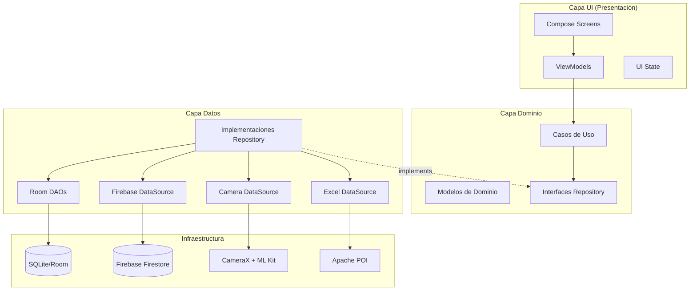
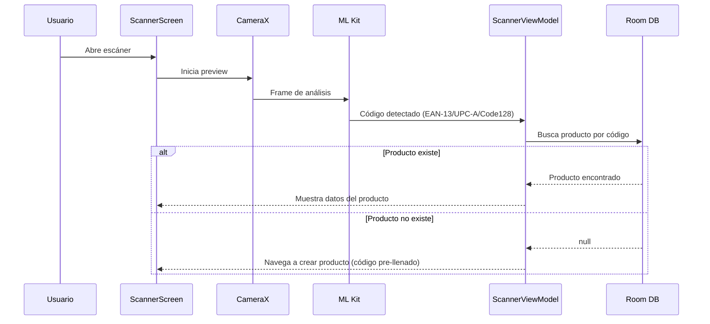
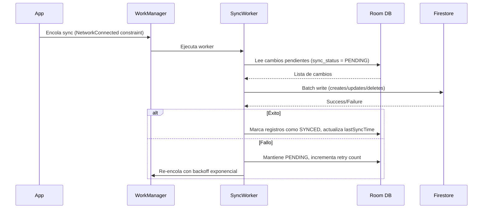
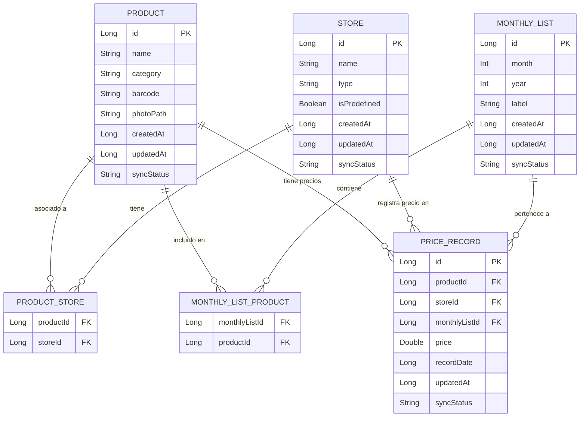

# Documento de Diseño Técnico: Market Shopping List

## Resumen General

La aplicación Market Shopping List es una app Android nativa construida con Kotlin y Jetpack Compose que permite gestionar listas de compras mensuales reutilizables. El diseño sigue una arquitectura Clean Architecture de tres capas (UI, Dominio, Datos) con enfoque offline-first, sincronización incremental con Firebase Firestore (tier gratuito), escaneo de códigos de barras mediante CameraX + ML Kit, y exportación a Excel con Apache POI.

### Decisiones Clave de Diseño

| Decisión | Elección | Justificación |
|----------|----------|---------------|
| UI Framework | Jetpack Compose | UI declarativa moderna, reduce boilerplate |
| Base de datos local | Room (SQLite) | Abstracción oficial de Android, validación SQL en compilación |
| Sincronización nube | Firebase Firestore (Spark plan) | 1 GiB almacenamiento, 50K lecturas/día, 20K escrituras/día gratuitas |
| Escaneo códigos | ML Kit Barcode Scanning | Offline nativo, soporta EAN-13/UPC-A/Code128, mejor rendimiento que ZXing |
| Cámara | CameraX | API moderna de cámara de Android, gestión automática del ciclo de vida |
| Excel | Apache POI (android5xlsx) | Genera .xlsx nativo, funciona offline |
| DI | Hilt | Inyección de dependencias oficial para Android |
| Async | Kotlin Coroutines + Flow | Programación reactiva y asíncrona idiomática |

## Arquitectura

### Diagrama de Capas



### Principios Arquitectónicos

1. **Offline-First**: Toda operación escribe primero en Room. La sincronización con Firestore es secundaria y asíncrona.
2. **Unidirectional Data Flow**: UI observa StateFlow del ViewModel → ViewModel invoca Use Cases → Use Cases operan sobre Repositories.
3. **Dependency Inversion**: La capa de dominio define interfaces; la capa de datos las implementa.
4. **Single Source of Truth**: Room es la fuente de verdad. Firestore es respaldo.

## Componentes e Interfaces

### Estructura de Paquetes

```
com.app.marketlist/
├── di/                          # Módulos Hilt
├── ui/
│   ├── navigation/              # NavGraph, rutas
│   ├── screens/
│   │   ├── home/                # Pantalla principal con lista mensual activa
│   │   ├── product/             # CRUD de productos
│   │   ├── store/               # CRUD de tiendas
│   │   ├── monthlylist/         # Gestión de listas mensuales
│   │   ├── scanner/             # Pantalla de cámara/escáner
│   │   ├── pricehistory/        # Historial de precios
│   │   └── export/              # Exportación Excel
│   ├── components/              # Componentes Compose reutilizables
│   └── theme/                   # Material3 Theme
├── domain/
│   ├── model/                   # Entidades de dominio
│   ├── repository/              # Interfaces de repositorio
│   └── usecase/                 # Casos de uso
└── data/
    ├── local/
    │   ├── db/                  # AppDatabase, entidades Room, DAOs
    │   └── photo/               # Gestión de archivos de foto
    ├── remote/
    │   └── firebase/            # FirestoreDataSource, modelos DTO
    ├── repository/              # Implementaciones de repositorios
    ├── camera/                  # BarcodeScanner, CameraManager
    └── export/                  # ExcelExporter
```

### Interfaces Principales

```kotlin
// --- Capa Dominio: Interfaces de Repositorio ---

interface ProductRepository {
    fun getProducts(monthlyListId: Long): Flow<List<Product>>
    fun searchProducts(query: String, monthlyListId: Long): Flow<List<Product>>
    fun getProductByBarcode(barcode: String): Flow<Product?>
    suspend fun createProduct(product: Product): Result<Long>
    suspend fun updateProduct(product: Product): Result<Unit>
    suspend fun deleteProduct(productId: Long): Result<Unit>
}

interface StoreRepository {
    fun getAllStores(): Flow<List<Store>>
    suspend fun createStore(store: Store): Result<Long>
    suspend fun updateStore(store: Store): Result<Unit>
    suspend fun deleteStore(storeId: Long): Result<Unit>
    fun isStorePredefined(storeId: Long): Boolean
}

interface MonthlyListRepository {
    fun getMonthlyLists(): Flow<List<MonthlyList>>
    fun getActiveMonthlyList(): Flow<MonthlyList?>
    suspend fun createMonthlyList(month: Int, year: Int): Result<MonthlyList>
    suspend fun copyFromPrevious(sourceListId: Long, targetListId: Long): Result<Unit>
    suspend fun addProductToList(productId: Long, listId: Long): Result<Unit>
    suspend fun removeProductFromList(productId: Long, listId: Long): Result<Unit>
}

interface PriceRepository {
    suspend fun registerPrice(priceRecord: PriceRecord): Result<Unit>
    fun getPriceHistory(productId: Long, lastNMonths: Int = 6): Flow<List<PriceRecord>>
    fun getPricesForList(monthlyListId: Long): Flow<List<PriceRecord>>
    fun getLowestPrice(productId: Long, monthlyListId: Long): Flow<PriceRecord?>
}

interface SyncRepository {
    suspend fun syncToCloud(): Result<SyncResult>
    fun getLastSyncTime(): Flow<LocalDateTime?>
    fun getPendingChangesCount(): Flow<Int>
}

interface ExcelExportRepository {
    suspend fun exportMonthlyList(monthlyListId: Long): Result<Uri>
}
```

### Casos de Uso Principales

```kotlin
// Gestión de Productos
class CreateProductUseCase(private val productRepo: ProductRepository)
class UpdateProductUseCase(private val productRepo: ProductRepository)
class DeleteProductUseCase(private val productRepo: ProductRepository)
class SearchProductsUseCase(private val productRepo: ProductRepository)

// Gestión de Tiendas
class CreateStoreUseCase(private val storeRepo: StoreRepository)
class DeleteStoreUseCase(private val storeRepo: StoreRepository)

// Lista Mensual
class CreateMonthlyListUseCase(
    private val monthlyListRepo: MonthlyListRepository
)
class CopyMonthlyListUseCase(
    private val monthlyListRepo: MonthlyListRepository,
    private val productRepo: ProductRepository
)

// Precios
class RegisterPriceUseCase(private val priceRepo: PriceRepository)
class GetPriceComparisonUseCase(private val priceRepo: PriceRepository)

// Escáner
class ScanBarcodeUseCase(
    private val productRepo: ProductRepository
)

// Sincronización
class SyncDataUseCase(private val syncRepo: SyncRepository)

// Exportación
class ExportToExcelUseCase(private val exportRepo: ExcelExportRepository)
```

### Componente de Escaneo de Código de Barras



**Configuración ML Kit**:
- Librería: `com.google.mlkit:barcode-scanning` (modelo on-device, no requiere internet)
- Formatos soportados: `Barcode.FORMAT_EAN_13`, `Barcode.FORMAT_UPC_A`, `Barcode.FORMAT_CODE_128`
- Integración con CameraX `ImageAnalysis` use case
- Timeout de decodificación: 5 segundos antes de mostrar fallback manual

### Componente de Exportación Excel

```kotlin
class ExcelExporter(
    private val context: Context
) {
    /**
     * Genera archivo .xlsx con el formato:
     * - Nombre: "Lista_[Mes]_[Año].xlsx"
     * - Columnas: Producto | Categoría | Tienda | Precio | Fecha_Registro
     * - Una fila por combinación Producto-Tienda con Precio_Registro
     * - Ordenado alfabéticamente por nombre de Producto
     */
    suspend fun export(
        monthlyList: MonthlyList,
        products: List<Product>,
        priceRecords: List<PriceRecord>
    ): Result<Uri>
}
```

**Implementación**: Usa Apache POI (`XSSFWorkbook`) empaquetado con [android5xlsx](https://github.com/andruhon/android5xlsx) para evitar conflictos de javax en Android. El archivo se genera en el directorio de caché de la app y se comparte mediante `FileProvider` + Android Sharesheet.

### Componente de Sincronización



**Estrategia de Sincronización Incremental**:
- Cada entidad tiene campos `updatedAt` (timestamp) y `syncStatus` (SYNCED, PENDING, CONFLICT)
- Solo se sincronizan registros con `syncStatus = PENDING`
- Resolución de conflictos: last-write-wins basado en `updatedAt`
- WorkManager con constraint de red para ejecutar automáticamente al recuperar conectividad
- No se sincronizan imágenes (solo metadatos y rutas locales)

## Modelos de Datos

### Diagrama Entidad-Relación



### Entidades Room

```kotlin
@Entity(tableName = "products")
data class ProductEntity(
    @PrimaryKey(autoGenerate = true) val id: Long = 0,
    @ColumnInfo(name = "name") val name: String,         // 2-100 chars
    @ColumnInfo(name = "category") val category: String,
    @ColumnInfo(name = "barcode") val barcode: String? = null,
    @ColumnInfo(name = "photo_path") val photoPath: String? = null,
    @ColumnInfo(name = "created_at") val createdAt: Long,
    @ColumnInfo(name = "updated_at") val updatedAt: Long,
    @ColumnInfo(name = "sync_status") val syncStatus: String = "PENDING"
)

@Entity(
    tableName = "stores",
    indices = [Index(value = ["name", "type"], unique = true)]
)
data class StoreEntity(
    @PrimaryKey(autoGenerate = true) val id: Long = 0,
    @ColumnInfo(name = "name") val name: String,         // 2-50 chars
    @ColumnInfo(name = "type") val type: String,         // SUPERMARKET | GENERAL_MARKET
    @ColumnInfo(name = "is_predefined") val isPredefined: Boolean = false,
    @ColumnInfo(name = "created_at") val createdAt: Long,
    @ColumnInfo(name = "updated_at") val updatedAt: Long,
    @ColumnInfo(name = "sync_status") val syncStatus: String = "PENDING"
)

@Entity(
    tableName = "monthly_lists",
    indices = [Index(value = ["month", "year"], unique = true)]
)
data class MonthlyListEntity(
    @PrimaryKey(autoGenerate = true) val id: Long = 0,
    @ColumnInfo(name = "month") val month: Int,          // 1-12
    @ColumnInfo(name = "year") val year: Int,
    @ColumnInfo(name = "label") val label: String,       // "Enero 2025"
    @ColumnInfo(name = "created_at") val createdAt: Long,
    @ColumnInfo(name = "updated_at") val updatedAt: Long,
    @ColumnInfo(name = "sync_status") val syncStatus: String = "PENDING"
)

@Entity(
    tableName = "product_store",
    primaryKeys = ["product_id", "store_id"],
    foreignKeys = [
        ForeignKey(entity = ProductEntity::class, parentColumns = ["id"], childColumns = ["product_id"], onDelete = ForeignKey.CASCADE),
        ForeignKey(entity = StoreEntity::class, parentColumns = ["id"], childColumns = ["store_id"], onDelete = ForeignKey.CASCADE)
    ]
)
data class ProductStoreEntity(
    @ColumnInfo(name = "product_id") val productId: Long,
    @ColumnInfo(name = "store_id") val storeId: Long
)
```

```kotlin
@Entity(
    tableName = "monthly_list_products",
    primaryKeys = ["monthly_list_id", "product_id"],
    foreignKeys = [
        ForeignKey(entity = MonthlyListEntity::class, parentColumns = ["id"], childColumns = ["monthly_list_id"], onDelete = ForeignKey.CASCADE),
        ForeignKey(entity = ProductEntity::class, parentColumns = ["id"], childColumns = ["product_id"], onDelete = ForeignKey.CASCADE)
    ]
)
data class MonthlyListProductEntity(
    @ColumnInfo(name = "monthly_list_id") val monthlyListId: Long,
    @ColumnInfo(name = "product_id") val productId: Long
)

@Entity(
    tableName = "price_records",
    indices = [
        Index(value = ["product_id", "store_id", "monthly_list_id"], unique = true)
    ],
    foreignKeys = [
        ForeignKey(entity = ProductEntity::class, parentColumns = ["id"], childColumns = ["product_id"], onDelete = ForeignKey.CASCADE),
        ForeignKey(entity = StoreEntity::class, parentColumns = ["id"], childColumns = ["store_id"], onDelete = ForeignKey.CASCADE),
        ForeignKey(entity = MonthlyListEntity::class, parentColumns = ["id"], childColumns = ["monthly_list_id"], onDelete = ForeignKey.CASCADE)
    ]
)
data class PriceRecordEntity(
    @PrimaryKey(autoGenerate = true) val id: Long = 0,
    @ColumnInfo(name = "product_id") val productId: Long,
    @ColumnInfo(name = "store_id") val storeId: Long,
    @ColumnInfo(name = "monthly_list_id") val monthlyListId: Long,
    @ColumnInfo(name = "price") val price: Double,       // 0.01 - 999999.99
    @ColumnInfo(name = "record_date") val recordDate: Long,
    @ColumnInfo(name = "updated_at") val updatedAt: Long,
    @ColumnInfo(name = "sync_status") val syncStatus: String = "PENDING"
)

@Entity(tableName = "sync_metadata")
data class SyncMetadataEntity(
    @PrimaryKey val key: String,
    @ColumnInfo(name = "value") val value: String
)
```

### Estructura Firestore

```
users/{userId}/
├── products/{productId}
│   ├── name: String
│   ├── category: String
│   ├── barcode: String?
│   ├── updatedAt: Timestamp
│   └── stores: [storeId1, storeId2, ...]
├── stores/{storeId}
│   ├── name: String
│   ├── type: String
│   ├── isPredefined: Boolean
│   └── updatedAt: Timestamp
├── monthlyLists/{listId}
│   ├── month: Int
│   ├── year: Int
│   ├── label: String
│   ├── productIds: [productId1, productId2, ...]
│   └── updatedAt: Timestamp
└── priceRecords/{recordId}
    ├── productId: String
    ├── storeId: String
    ├── monthlyListId: String
    ├── price: Double
    ├── recordDate: Timestamp
    └── updatedAt: Timestamp
```

**Consideraciones de uso del tier gratuito**:
- Spark plan: 1 GiB almacenamiento, 20K escrituras/día, 50K lecturas/día, 20K eliminaciones/día
- Solo se sincronizan datos estructurales (no fotos) para mantenerse dentro de límites
- La app monitorea el uso y notifica al usuario si se acerca al límite
- Estrategia de batch writes para minimizar operaciones individuales

### Modelos de Dominio

```kotlin
data class Product(
    val id: Long = 0,
    val name: String,
    val category: String,
    val barcode: String? = null,
    val photoPath: String? = null,
    val stores: List<Store> = emptyList()
)

data class Store(
    val id: Long = 0,
    val name: String,
    val type: StoreType,
    val isPredefined: Boolean = false
)

enum class StoreType { SUPERMARKET, GENERAL_MARKET }

data class MonthlyList(
    val id: Long = 0,
    val month: Int,
    val year: Int,
    val label: String,
    val products: List<Product> = emptyList()
)

data class PriceRecord(
    val id: Long = 0,
    val productId: Long,
    val storeId: Long,
    val monthlyListId: Long,
    val price: Double,
    val recordDate: LocalDate,
    val storeName: String? = null
)

data class SyncResult(
    val success: Boolean,
    val syncedCount: Int,
    val failedCount: Int,
    val lastSyncTime: LocalDateTime?
)
```

## Propiedades de Correctitud

*Una propiedad es una característica o comportamiento que debe mantenerse verdadero en todas las ejecuciones válidas de un sistema — esencialmente, una declaración formal sobre lo que el sistema debería hacer. Las propiedades sirven como puente entre especificaciones legibles por humanos y garantías de correctitud verificables por máquina.*

### Propiedad 1: Round-trip de persistencia de productos

*Para cualquier* producto con nombre válido (2-100 caracteres), categoría no vacía y al menos una tienda asociada, al crearlo o editarlo y luego leerlo de la base de datos, se deberá obtener un producto con los mismos datos ingresados.

**Valida: Requisitos 1.1, 1.3**

### Propiedad 2: Validación de campos obligatorios rechaza datos incompletos

*Para cualquier* combinación de campos donde nombre, categoría o tienda estén ausentes o vacíos, la operación de creación/edición deberá fallar reportando exactamente los campos faltantes, sin modificar el estado de la base de datos.

**Valida: Requisitos 1.2**

### Propiedad 3: Eliminación en cascada de productos

*Para cualquier* producto con N registros de precio asociados (N >= 0), al confirmar su eliminación, ni el producto ni ninguno de sus registros de precio deberán existir en la base de datos, y todo producto existente debe tener al menos una tienda asociada.

**Valida: Requisitos 1.5, 1.6**

### Propiedad 4: Búsqueda parcial case-insensitive

*Para cualquier* término de búsqueda de al menos 1 carácter y cualquier conjunto de productos, todos los resultados retornados deberán contener el término (ignorando mayúsculas/minúsculas) en su nombre o categoría, y ningún producto que contenga el término deberá ser excluido de los resultados.

**Valida: Requisitos 1.7, 9.1**

### Propiedad 5: Unicidad de tiendas por nombre y tipo

*Para cualquier* par (nombre, tipo) que ya existe como tienda en la base de datos, intentar crear otra tienda con el mismo nombre y tipo deberá ser rechazado, manteniendo la tienda original sin cambios.

**Valida: Requisitos 2.3**

### Propiedad 6: Tiendas predefinidas son indestructibles

*Para cualquier* tienda marcada como predefinida, toda operación de eliminación deberá fallar y la tienda deberá seguir existiendo en la base de datos con todos sus datos intactos.

**Valida: Requisitos 2.7**

### Propiedad 7: Copia de lista preserva productos sin precios

*Para cualquier* lista mensual con N productos (N <= 500) y precios registrados, al copiarla a una nueva lista, la nueva lista deberá contener exactamente los mismos N productos (mismo nombre, categoría, tiendas) pero con cero registros de precio asociados.

**Valida: Requisitos 3.1, 3.2**

### Propiedad 8: Unicidad de lista mensual por mes/año

*Para cualquier* par (mes, año) que ya tiene una lista mensual, intentar crear otra lista para el mismo mes y año deberá ser rechazado, manteniendo la lista original sin cambios.

**Valida: Requisitos 3.3, 3.7**

### Propiedad 9: Historial de listas ordenado descendente por fecha

*Para cualquier* conjunto de listas mensuales, al consultar el historial, la secuencia retornada deberá estar estrictamente ordenada de la más reciente a la más antigua (año descendente, luego mes descendente).

**Valida: Requisitos 3.4**

### Propiedad 10: Aislamiento entre listas mensuales

*Para cualquier* lista mensual activa y cualquier lista mensual anterior, agregar o quitar productos de la lista activa no deberá alterar la cantidad ni los datos de los productos en las listas anteriores.

**Valida: Requisitos 3.5**

### Propiedad 11: Validación de rango de precio

*Para cualquier* valor numérico, si está en el rango [0.01, 999999.99] con máximo 2 decimales, deberá ser aceptado como precio válido; si está fuera de ese rango o no tiene formato numérico válido, deberá ser rechazado.

**Valida: Requisitos 4.1, 4.2**

### Propiedad 12: Unicidad de precio por combinación Producto-Tienda-Lista

*Para cualquier* combinación de (producto, tienda, lista_mensual), deberá existir como máximo un registro de precio. Intentar insertar un segundo registro para la misma combinación sin confirmación deberá fallar.

**Valida: Requisitos 4.3**

### Propiedad 13: Historial de precios limitado a últimas 6 listas

*Para cualquier* producto con precios en N listas mensuales (N > 6), al consultar su historial, solo deberán mostrarse los precios de las 6 listas más recientes, ordenados por fecha descendente.

**Valida: Requisitos 4.5**

### Propiedad 14: Identificación correcta del precio mínimo

*Para cualquier* producto con múltiples precios en diferentes tiendas dentro de una misma lista mensual, el precio identificado como mínimo deberá ser menor o igual a todos los demás precios registrados para ese producto en esa lista.

**Valida: Requisitos 4.6**

### Propiedad 15: Lookup por código de barras

*Para cualquier* código de barras almacenado en la base de datos asociado a un producto, buscar por ese código deberá retornar exactamente el producto asociado. Para códigos no almacenados, la búsqueda deberá retornar vacío.

**Valida: Requisitos 5.2, 9.2**

### Propiedad 16: Validación de código de barras manual

*Para cualquier* cadena de caracteres, solo deberá ser aceptada como código de barras manual si contiene exclusivamente dígitos numéricos y su longitud está entre 8 y 14 caracteres inclusive.

**Valida: Requisitos 5.6**

### Propiedad 17: Resolución de conflictos last-write-wins

*Para cualquier* par de versiones en conflicto del mismo registro (mismo ID), la versión con el timestamp `updatedAt` más reciente deberá prevalecer y la versión anterior deberá ser descartada.

**Valida: Requisitos 7.3**

### Propiedad 18: Operaciones offline generan sync pendiente

*Para cualquier* operación CRUD realizada sin conexión a internet, el registro afectado deberá tener su campo `syncStatus` establecido como "PENDING" después de la operación.

**Valida: Requisitos 7.4**

### Propiedad 19: Formato de fecha de sincronización

*Para cualquier* fecha y hora válida, el formato de visualización de última sincronización deberá cumplir estrictamente el patrón "dd/MM/yyyy HH:mm" (día con 2 dígitos, mes con 2 dígitos, año con 4 dígitos, hora 24h con 2 dígitos, minutos con 2 dígitos).

**Valida: Requisitos 7.5**

### Propiedad 20: Exportación Excel con nombre, estructura y orden correctos

*Para cualquier* lista mensual con productos y precios, el archivo exportado deberá: (a) nombrarse "Lista_[Mes]_[Año].xlsx", (b) contener exactamente las columnas Producto, Categoría, Tienda, Precio, Fecha_Registro, (c) tener una fila por cada combinación Producto-Tienda con precio registrado, y (d) estar ordenado alfabéticamente por nombre de Producto.

**Valida: Requisitos 8.1, 8.2**

### Propiedad 21: Foto placeholder cuando archivo no existe

*Para cualquier* producto cuya ruta de foto referencia un archivo que no existe en el sistema de archivos, la consulta del producto deberá retornar un indicador de imagen placeholder en lugar de una ruta inválida.

**Valida: Requisitos 6.4**

### Propiedad 22: Restaurar vista completa al limpiar búsqueda

*Para cualquier* estado de búsqueda filtrada en una lista mensual activa con N productos totales, al limpiar el campo de búsqueda, la vista deberá mostrar exactamente los N productos de la lista activa.

**Valida: Requisitos 9.6**

## Manejo de Errores

### Estrategia General

| Capa | Mecanismo | Acción |
|------|-----------|--------|
| UI | `try-catch` en ViewModel | Muestra Snackbar/Dialog al usuario |
| Dominio | `Result<T>` wrapper | Propaga error tipado al ViewModel |
| Datos (Room) | `try-catch` en Repository | Retorna `Result.failure()` con excepción |
| Datos (Firebase) | `try-catch` + retry | Encola para retry, notifica sync fallida |
| Datos (Cámara) | Timeout + fallback | Muestra ingreso manual tras 5s |
| Datos (Excel) | `try-catch` | Reporta causa (permisos, almacenamiento) |

### Errores Específicos

```kotlin
sealed class AppError {
    // Validación
    data class ValidationError(val fields: List<String>) : AppError()
    data class DuplicateError(val entity: String, val name: String) : AppError()
    data class PredefinedEntityError(val message: String) : AppError()
    
    // Almacenamiento
    data class DatabaseError(val cause: Throwable) : AppError()
    data class StorageFullError(val requiredSpace: Long) : AppError()
    
    // Sincronización
    data class SyncError(val cause: Throwable) : AppError()
    data class CloudStorageLimitError(val message: String) : AppError()
    
    // Cámara/Escáner
    data class CameraPermissionError(val message: String) : AppError()
    data class BarcodeTimeoutError(val message: String) : AppError()
    
    // Exportación
    data class ExportPermissionError(val message: String) : AppError()
    data class ExportWriteError(val cause: Throwable) : AppError()
    data class ExportEmptyListError(val listName: String) : AppError()
}
```

### Principios de Resiliencia

1. **Nunca perder datos del usuario**: Toda operación de escritura confirma persistencia antes de reportar éxito.
2. **Degradación graceful**: Si Firestore falla, la app funciona 100% offline.
3. **Feedback inmediato**: El usuario siempre sabe si una operación tuvo éxito o no.
4. **Sin corrupción**: Transacciones Room garantizan atomicidad. Fallo = rollback.
5. **Retry automático**: Sincronización con backoff exponencial via WorkManager.

## Estrategia de Pruebas

### Enfoque Dual de Pruebas

La estrategia combina pruebas unitarias basadas en ejemplos con pruebas basadas en propiedades para cobertura completa.

### Pruebas Unitarias (Ejemplos y Casos Específicos)

| Área | Qué se prueba | Framework |
|------|---------------|-----------|
| ViewModels | Flujos de UI state, navegación | JUnit5 + Turbine |
| Use Cases | Lógica de negocio con datos concretos | JUnit5 + MockK |
| DAOs | Queries Room con datos predefinidos | AndroidX Test + Room in-memory DB |
| UI Components | Renderizado Compose | Compose Testing |
| Integración | Flujos end-to-end | AndroidX Instrumented Tests |

### Pruebas Basadas en Propiedades

**Librería**: [Kotest Property Testing](https://kotest.io/docs/proptest/property-based-testing.html) — librería de PBT idiomática para Kotlin.

**Configuración**: Mínimo 100 iteraciones por propiedad.

**Propiedades a implementar** (referenciando el documento de diseño):

| # | Propiedad | Tag |
|---|-----------|-----|
| 1 | Round-trip persistencia productos | Feature: market-shopping-list, Property 1: Round-trip de persistencia de productos |
| 2 | Validación campos obligatorios | Feature: market-shopping-list, Property 2: Validación de campos obligatorios rechaza datos incompletos |
| 3 | Eliminación en cascada | Feature: market-shopping-list, Property 3: Eliminación en cascada de productos |
| 4 | Búsqueda parcial case-insensitive | Feature: market-shopping-list, Property 4: Búsqueda parcial case-insensitive |
| 5 | Unicidad de tiendas | Feature: market-shopping-list, Property 5: Unicidad de tiendas por nombre y tipo |
| 6 | Tiendas predefinidas indestructibles | Feature: market-shopping-list, Property 6: Tiendas predefinidas son indestructibles |
| 7 | Copia lista sin precios | Feature: market-shopping-list, Property 7: Copia de lista preserva productos sin precios |
| 8 | Unicidad lista mensual | Feature: market-shopping-list, Property 8: Unicidad de lista mensual por mes/año |
| 9 | Orden historial descendente | Feature: market-shopping-list, Property 9: Historial de listas ordenado descendente por fecha |
| 10 | Aislamiento entre listas | Feature: market-shopping-list, Property 10: Aislamiento entre listas mensuales |
| 11 | Validación rango precio | Feature: market-shopping-list, Property 11: Validación de rango de precio |
| 12 | Unicidad precio por combinación | Feature: market-shopping-list, Property 12: Unicidad de precio por combinación Producto-Tienda-Lista |
| 13 | Historial últimas 6 listas | Feature: market-shopping-list, Property 13: Historial de precios limitado a últimas 6 listas |
| 14 | Precio mínimo correcto | Feature: market-shopping-list, Property 14: Identificación correcta del precio mínimo |
| 15 | Lookup código de barras | Feature: market-shopping-list, Property 15: Lookup por código de barras |
| 16 | Validación código manual | Feature: market-shopping-list, Property 16: Validación de código de barras manual |
| 17 | Conflictos last-write-wins | Feature: market-shopping-list, Property 17: Resolución de conflictos last-write-wins |
| 18 | Sync status PENDING | Feature: market-shopping-list, Property 18: Operaciones offline generan sync pendiente |
| 19 | Formato fecha sync | Feature: market-shopping-list, Property 19: Formato de fecha de sincronización |
| 20 | Exportación Excel | Feature: market-shopping-list, Property 20: Exportación Excel con nombre, estructura y orden correctos |
| 21 | Foto placeholder | Feature: market-shopping-list, Property 21: Foto placeholder cuando archivo no existe |
| 22 | Restaurar vista búsqueda | Feature: market-shopping-list, Property 22: Restaurar vista completa al limpiar búsqueda |

### Generadores Kotest Personalizados

```kotlin
// Generadores para pruebas de propiedades
val validProductNameArb = Arb.string(2..100, Codepoint.alphanumeric())
val validStoreNameArb = Arb.string(2..50, Codepoint.alphanumeric())
val validPriceArb = Arb.double(0.01..999999.99)
    .map { (it * 100).roundToInt() / 100.0 } // 2 decimales
val invalidPriceArb = Arb.choice(
    Arb.double(Double.MIN_VALUE..0.009),
    Arb.double(999999.991..Double.MAX_VALUE)
)
val validBarcodeArb = Arb.string(8..14, Codepoint.digit())
val storeTypeArb = Arb.enum<StoreType>()
val monthArb = Arb.int(1..12)
val yearArb = Arb.int(2020..2030)
```

### Pruebas de Integración

| Escenario | Qué se verifica |
|-----------|-----------------|
| Sincronización offline → online | Datos locales se sincronizan correctamente a Firestore |
| Escaneo de código de barras | CameraX + ML Kit decodifica correctamente |
| Exportación Excel | Archivo .xlsx generado es legible y tiene formato correcto |
| Persistencia entre reinicios | Datos sobreviven kill de proceso y reinicio de app |
| Rendimiento búsqueda | < 1 segundo con 500 productos |
