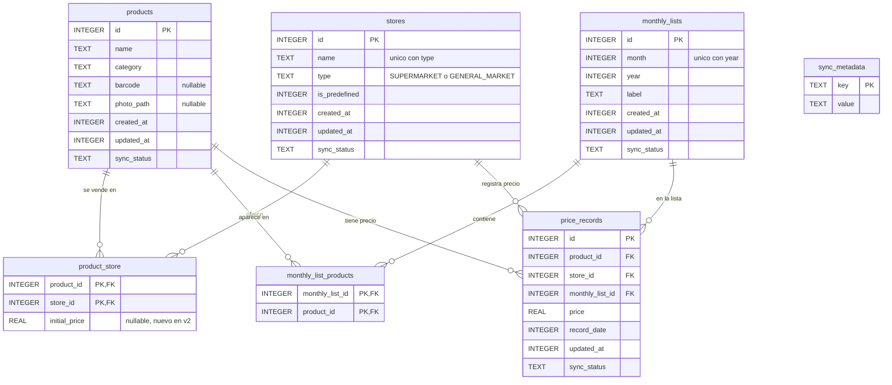

# Base de datos: modelo entidad-relación (Room v2)

Diagrama editable: [base-de-datos-er.drawio](base-de-datos-er.drawio) (se abre en https://app.diagrams.net).

**En lenguaje llano.** La app guarda todo en una base SQLite local (`market_list_database`) que funciona sin internet. Hay tres "catálogos" (productos, tiendas, listas mensuales) y tres tablas que los relacionan:

- `product_store`: en qué tiendas se vende un producto y, opcionalmente, su **precio inicial por tienda** (novedad de la versión 2).
- `monthly_list_products`: qué productos forman parte de cada lista mensual.
- `price_records`: el precio registrado de un producto, en una tienda, dentro de una lista.

`sync_metadata` es una tabla suelta que solo guarda datos de control de la sincronización.

**Detalle técnico.** Fuente de verdad: entidades y DAOs en `app/src/main/java/com/app/marketlist/data/local/db/` y esquema exportado `app/schemas/com.app.marketlist.data.local.db.AppDatabase/2.json`. `AppDatabase` declara `version = 2` y `exportSchema = true`. Todas las claves foráneas usan `ON DELETE CASCADE` y `ON UPDATE NO ACTION`.

## Diagrama (Mermaid)



## Tablas

Leyenda: "Nulo" = acepta NULL. Los booleanos de Kotlin se guardan como INTEGER (0/1). Las fechas se guardan como INTEGER (milisegundos desde 1970). `sync_status` toma los valores `PENDING` (por defecto en Kotlin, aún no subido) o `SYNCED`.

### `products` (ProductEntity)

| Campo | Tipo | Nulo | Clave | Descripción |
|---|---|---|---|---|
| id | INTEGER | No | PK, autoincremental | Identificador |
| name | TEXT | No | | Nombre del producto |
| category | TEXT | No | | Categoría (los de ticket nuevos usan "Otros") |
| barcode | TEXT | Sí | | Código de barras |
| photo_path | TEXT | Sí | | Ruta de la foto local (no se sincroniza) |
| created_at | INTEGER | No | | Creación |
| updated_at | INTEGER | No | | Última modificación |
| sync_status | TEXT | No | | Estado de sincronización |

Índices: ninguno adicional.

### `stores` (StoreEntity)

| Campo | Tipo | Nulo | Clave | Descripción |
|---|---|---|---|---|
| id | INTEGER | No | PK, autoincremental | Identificador |
| name | TEXT | No | | Nombre de la tienda |
| type | TEXT | No | | `SUPERMARKET` o `GENERAL_MARKET` (enum StoreType) |
| is_predefined | INTEGER | No | | 1 si es una tienda precargada |
| created_at | INTEGER | No | | Creación |
| updated_at | INTEGER | No | | Última modificación |
| sync_status | TEXT | No | | Estado de sincronización |

Índice único: `index_stores_name_type` (name, type).
Datos iniciales (`PrepopulateCallback`, solo al crear la base): Walmart, 3B, Sams, Gran Bodega (SUPERMARKET) y Mercado_Local (GENERAL_MARKET).

### `monthly_lists` (MonthlyListEntity)

| Campo | Tipo | Nulo | Clave | Descripción |
|---|---|---|---|---|
| id | INTEGER | No | PK, autoincremental | Identificador |
| month | INTEGER | No | | Mes del período |
| year | INTEGER | No | | Año del período |
| label | TEXT | No | | Nombre libre de la lista (se sugiere por mes) |
| created_at | INTEGER | No | | Creación |
| updated_at | INTEGER | No | | Última modificación |
| sync_status | TEXT | No | | Estado de sincronización |

Índice único: `index_monthly_lists_month_year` (month, year). Por eso no puede haber dos listas del mismo período.

### `product_store` (ProductStoreEntity)

| Campo | Tipo | Nulo | Clave | Descripción |
|---|---|---|---|---|
| product_id | INTEGER | No | PK, FK → products.id | Producto |
| store_id | INTEGER | No | PK, FK → stores.id | Tienda |
| initial_price | REAL | Sí | | Precio inicial opcional de ese producto en esa tienda (v2) |

Clave primaria compuesta (product_id, store_id): un solo precio inicial por par producto-tienda. Índices no únicos: `index_product_store_product_id`, `index_product_store_store_id`.

### `monthly_list_products` (MonthlyListProductEntity)

| Campo | Tipo | Nulo | Clave | Descripción |
|---|---|---|---|---|
| monthly_list_id | INTEGER | No | PK, FK → monthly_lists.id | Lista |
| product_id | INTEGER | No | PK, FK → products.id | Producto |

Clave primaria compuesta (monthly_list_id, product_id). Índices no únicos: `index_monthly_list_products_monthly_list_id`, `index_monthly_list_products_product_id`.

### `price_records` (PriceRecordEntity)

| Campo | Tipo | Nulo | Clave | Descripción |
|---|---|---|---|---|
| id | INTEGER | No | PK, autoincremental | Identificador |
| product_id | INTEGER | No | FK → products.id | Producto |
| store_id | INTEGER | No | FK → stores.id | Tienda |
| monthly_list_id | INTEGER | No | FK → monthly_lists.id | Lista mensual |
| price | REAL | No | | Precio (validado entre 0.01 y 999999.99, 2 decimales) |
| record_date | INTEGER | No | | Fecha del registro (en tickets, la fecha de la compra) |
| updated_at | INTEGER | No | | Última modificación |
| sync_status | TEXT | No | | Estado de sincronización |

Índice único: `index_price_records_product_id_store_id_monthly_list_id` (product_id, store_id, monthly_list_id): un precio por producto, tienda y lista. Índices no únicos: `index_price_records_product_id`, `index_price_records_store_id`, `index_price_records_monthly_list_id`.

### `sync_metadata` (SyncMetadataEntity)

| Campo | Tipo | Nulo | Clave | Descripción |
|---|---|---|---|---|
| key | TEXT | No | PK | Nombre del dato (por ejemplo, última sincronización) |
| value | TEXT | No | | Valor |

Sin claves foráneas ni índices adicionales.

## Migración 1 → 2

Definida en `Migrations.kt` y registrada en `DatabaseModule` con `addMigrations(MIGRATION_1_2)`:

```sql
ALTER TABLE product_store ADD COLUMN initial_price REAL
```

La columna acepta NULL y no tiene valor por defecto, así que los datos de la versión 1 se conservan sin cambios. Es el único cambio del esquema entre 1 y 2.

## Cómo la lectura de tickets usa el esquema

La importación de un ticket (`TicketImportRepositoryImpl`) no cambia el esquema. En una sola transacción crea:

1. Una fila en `monthly_lists`, con el período libre más cercano a la fecha del ticket hacia atrás (respeta el índice único month+year).
2. Opcionalmente, filas en `monthly_list_products` copiadas de otra lista (`copyFromListId`, hasta 500 productos).
3. Por cada artículo nuevo, una fila en `products` (categoría "Otros") y otra en `product_store` con `initial_price` nulo.
4. Por cada artículo (nuevo o existente), una fila en `monthly_list_products` y una en `price_records` (con inserción que reemplaza si ya existía el mismo producto, tienda y lista).

## Leer lista por foto e importar Excel

No hay cambios de esquema (Room sigue en v2). Las listas leídas por foto y los productos importados de Excel usan las mismas tablas. El precio sugerido (último `PriceRecord` del producto) solo se muestra en pantalla; únicamente se guarda como `PriceRecord` si el usuario pulsa "Usar" o escribe el precio.

## Sincronización con Firestore

Solo `products`, `stores`, `monthly_lists` y `price_records` se suben a Firestore (filas con `sync_status = PENDING`). `product_store`, `monthly_list_products` y `sync_metadata` no se suben.
